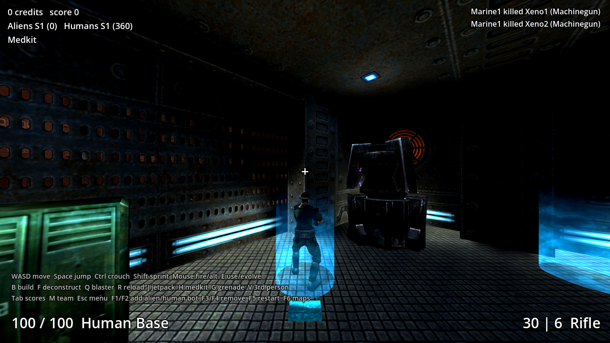
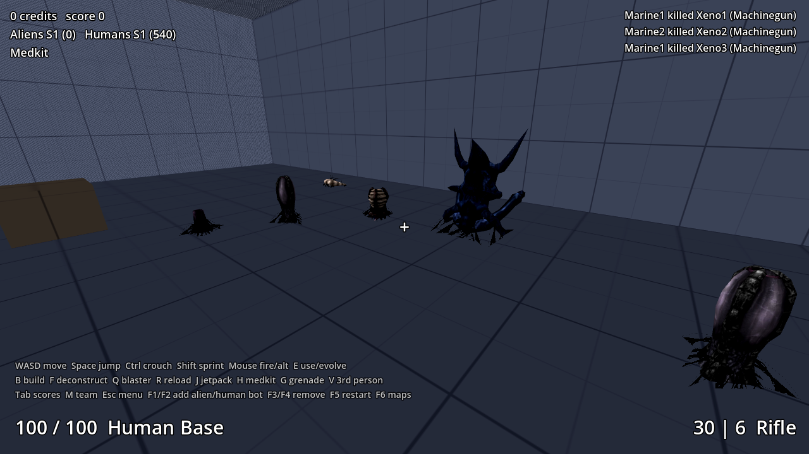
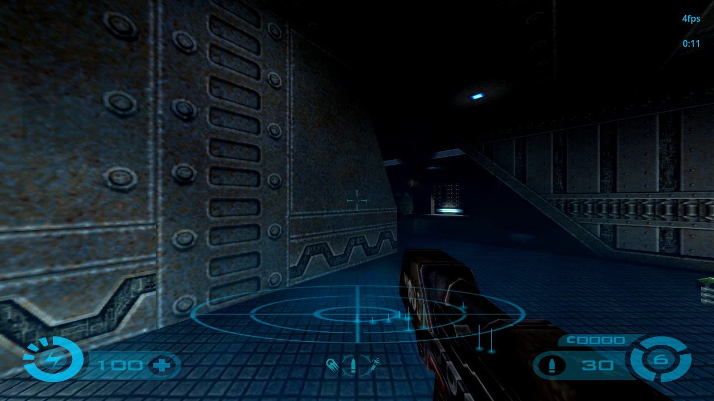
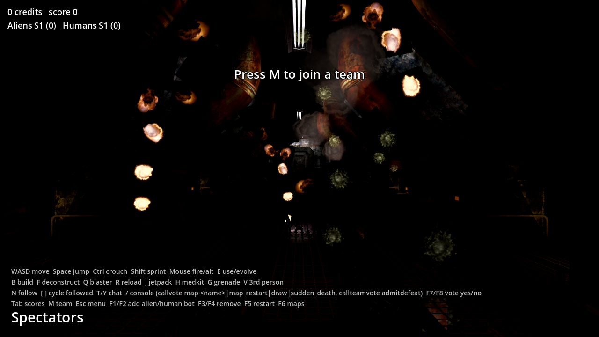

# Tremulous → Godot 4 + Rust (Spreadsheet Method port)

A port of [tremulous-legacy](https://github.com/darklegion/tremulous-legacy)
(pinned at `c862a534`) to **Godot 4.7** with all gameplay in **Rust**, built
the way `THE-SPREADSHEET-METHOD.json` / `Rust Spreadsheet Game Workflow.txt`
prescribe: the TSV sheet book is the source of truth, a preflight gates every
build, generated code never touches the source tree, and the movement and
collision code is held bit-exact to the original C by golden traces.






```
sheets/           the book: doctrine, schema, enums, plan/impl, kernel allowlist,
                  decisions, work/tokens ledgers, 18 domain sheets, symbol map
crates/sheetty    preflight L0–L7 + emitter (tables, consts, enums, PHF registry,
                  fn tables, path checks)      crates/sheetty-cli: the CLI
crates/trem_sim   engine-agnostic simulation: generated tables + 42 kernels
crates/trem_godot GDExtension: TremGame node (input, fixed tick, rendering, BSP view),
                  TremHud (original menu-script HUD), cgame particles/trails/marks
godot/            Godot project (main.tscn, hud.gd, tests/*.tscn, bin/ libraries)
re/               original source, C reference harness, golden traces, evidence
```

## Play

1. Install Godot **4.7** (standard build).
2. Open `godot/project.godot` and press Play (F5). Prebuilt libraries are in
   `godot/bin/` for Linux x86_64 (`libtrem_godot.so`) and Windows x86_64
   (`trem_godot.dll`). On macOS, build it yourself (below).
3. The original start sequence runs: the `splash.RoQ` intro (any key skips it),
   then the main menu of `ui/main.menu` with its splash model and heartbeat loop.
   Play opens the server browser (LAN scan, master servers, favorites; dec035)
   whose Create Server starts a joinable listen server on a map; Options edits the engine cvars
   (video mode, brightness, volumes, ... kept in `autogen.cfg`); Leave in the
   in-game menu comes back here. `-- +map atcs` starts on a map directly.
4. Choose a team, then a spawn item or class. Three bots per side join by default.

Controls are the original's: the bind table of the game data's `default.cfg`
(a built-in copy without data), then `user://autogen.cfg` (written whenever a
bind or archived cvar changes) and `user://autoexec.cfg`. WASD/arrows move ·
Space jump · C crouch · Shift walk · X sprint · Z dodge · Mouse1/Ctrl fire ·
Mouse2 alt-fire · Q use structure / evolve · `[` `]` / wheel select item, Enter /
Mouse3 use it · R reload · B buy ammo · M medkit · E deconstruct · F gesture ·
T/Y chat · Tab scores · F1/F2 vote yes/no · Esc menu · `~` console: the
original drop-down console with its scrollback (PgUp/PgDn), edit line,
history (Up/Down, kept in `user://q3history`) and Tab completion of commands,
cvars, keys and cfg files; `/bind`, `/bindlist`, `/exec`, cvars,
`/callvote map nexus6`, `/give all` with cheats… (text without a slash is
chat in a game, as in the original). `name` (or Options → player name) is
your name; the cgame's `testmodel`, `testgun`, `testPS`, `testTS`,
`cg_drawBBOX` and `cg_drawSurfNormal` debugging tools work. A gamepad works
like the original's SDL joystick after `seta in_joystick 1; in_restart`
(buttons and the d-pad are JOY1…32 keys to `bind`; `in_joystickUseAnalog 1`
drives the `j_*` analog movement cvars); default.cfg binds none.
The Controls tab of the Esc → Options menu rebinds keys. Port additions on
keys default.cfg leaves free: V third person · F3/F4 add alien/human bot ·
F5/F6 remove · F7 restart · F8 maps · F9 help.

**Original Tremulous content is included.** `godot/base/` holds the unmodified
Tremulous 1.1.0 pk3s (game data + the 8 official maps), CC BY-SA 2.5 — see
`godot/base/COPYING`, `CC` and `README.txt` (dec016). Create Server (or `+map`) starts e.g. **ATCS**
with the original:

* MD3 models with their skins — human base/light armour/helmet/battlesuit,
  all alien classes, every buildable, weapons and the first-person hands;
* animations driven by each model's `animation.cfg` (legs/torso/gestures for
  humans, non-segmented alien animations, buildable construct/idle/attack/pain/
  destroy), interpolated per frame on the GPU (vertex-animation textures);
* sounds — weapon fire/impacts, footsteps, jumps, falls, pain/death,
  buildable loops and events, stage announcements;
* maps drawn stage by stage from their shader scripts (every stage's blend,
  rgbGen / alphaGen waves, tcGen / tcMods, animMap, deformVertexes and
  polygonOffset decals; dec043), skies with their cloud layers, fog volumes,
  lightmaps and light-grid lighting for models, curved-patch collision, doors/lifts/trains/buttons and every
  trigger, target and misc entity of the 8 maps;
* the cgame effects: every particle system and trail of `scripts/*.particle`
  and `*.trail` (impacts, muzzles, missiles, blood, explosions and gibs,
  jetpack, acid tubes, tesla and lev2 zap beams, map particle systems), impact
  marks, alien creep and blob shadows (mark polys clipped to the map's
  surfaces like the original's R_MarkFragments, dec030), and the original HUD from
  `ui/tremulous_*_hud.menu` with its ring/arm art, number font, scanner and
  alien sense.

F6 switches maps. More pk3s can go in `user://base`, `base/` next to the
executable, or `--base=DIR`. Without any data pk3 the game falls back to the
sheet-authored arena with primitive models.

## Multiplayer (dec033 .. dec035, dec037)

The original protocol 71 is ported (Huffman, msg deltas, netchan bit-exact
against the C), with a server over the World and a client/cgame that renders
from snapshots with prediction. The single-process game stays the default.

* **Host a listen server**: the main menu's Play → Create Server, or
  `-- +set net_enabled 1 +map atcs` (console: `set net_enabled 1`, then
  `map atcs`). It listens on UDP `net_port` (30720, the next free of ten);
  `sv_hostname`, `sv_maxclients`, `rconPassword`, `g_password`, `dedicated 2`
  (announce to `sv_master1..5`) apply. The host's own player joins over the
  loopback and is the top admin; remote players identify by `cl_guid`.
* **Join**: the server browser (LAN / Internet / Favorites, pinged), or the
  console `connect 192.168.1.10[:30720]`, `reconnect`, `disconnect`;
  `localservers`, `globalservers 0 full empty`, `ping`, `serverstatus`,
  `rcon <cmd>` (with `rconPassword`), `heartbeat`, `serverinfo`, `systeminfo`,
  `killserver`. The player name is the `name` cvar; `cl_guid` is the MD5 of
  `user://qkey` (generated once).
* **Dedicated server**: headless Godot,
  `godot --headless --path godot -- +set dedicated 1 +map atcs` (`dedicated 2`
  sends heartbeats to the masters; no rendering, menus or audio; stdin is the
  server console; `--base=DIR` adds a pk3 folder), or without Godot:
  `cargo run --release -p trem_sim --example dedicated -- +set sv_hostname "My server" +set rconPassword secret +map atcs`
  (stdin is the server console; maps come from `godot/base` or `--base=DIR`;
  admin.dat, layouts and games.log go to `fs_homepath`, default `./dedicated-home`).
* **Pure servers and downloads** (dec037): servers run `sv_pure 1` like the
  original (clients must use the server's pk3s; the pk3 checksums are the
  original's, checked against its files.c / md4.c), and `sv_allowDownload 1`
  lets clients fetch the referenced pk3s they lack. The client asks first
  (the original download popup) unless `cl_allowDownload 1`; downloads land
  in `user://base` and are used at once. `fs_openedList` / `fs_referencedList`.
* **Demos** (dec037): `record [name]`, `stoprecord`, `demo <name>` (also the
  Demos menu), `timedemo 1`, `cl_autoRecordDemo 1`; files are
  `user://demos/<name>.dm_71` in the original format. Recording a
  single-player game restarts its map on a local loopback server, as the
  original always plays.
* **IPv6** (dec037): `net_enabled` bits as in the original (1 ipv4, 2 ipv6,
  4 prefer ipv6, 8 no multicast; the port's 0 means single process and opens
  both families for a client), `connect -6 [::1]:30720`, `net_ip6`,
  `net_port6`, and the LAN scan through the `net_mcast6addr` multicast group.
* **Headless client / interop probe**:
  `cargo run --release -p trem_sim --example net_probe -- 127.0.0.1:30720 20`
  joins any protocol 71 server (an original 1.2/legacy `tremded` too), walks,
  fires and prints what it sees.
* Interop: the port's client joins an original tremulous-legacy `tremded`
  (built from `re/source`) and plays (team, spawn, move, fire, clean
  disconnect). An original client against the port's server is untested here
  (no SDL in the build container); the server's packets come from the same
  verified msg/netchan code. Not supported: cURL downloads (UDP only).
* **Vanilla 1.1.0 servers** (dec040, dec041): the client also speaks
  Tremulous 1.1.0's protocol 69, so it joins vanilla servers as well as
  1.3 / legacy (71) ones. Options → Server Protocol: Auto (default: asks
  the server and uses its protocol), 1.3 (71) or 1.1 (69); the console
  takes `connect host -69` / `-71` (`-1` as in GrangerHub's client). The
  browser lists both (the Game Type column says "base 1.1" or "base 1.3";
  Version: All / 1.3 / 1.1 filters) and joins each with its own protocol.
  On a 1.1 server the 1.1 game is used: its weapons, classes, buildables
  (the hovel, the advanced construction kit), prices, HUD values and its
  own movement for prediction (byte-exact against 1.1.0's bg_pmove.c).
  A pure 1.1 server (`sv_pure 1`) also wants its vms-1.1.0.pk3: with
  `sv_allowDownload 1` the client fetches it, else put it in the base
  folder. Not supported: GPP / 1.2 servers (protocol 70), demos of 1.1
  games.
* **Online play** (dec039): the Internet tab lists master.tremulous.net's
  servers (the request carries protocol 71, which that master needs; the
  C's game-name request got an empty list). Servers of other protocols
  (1.1's 69, GPP's 70) are not listed; mod servers on protocol 71 are
  listed but run game code the port does not have. To host for players
  outside your network set Create Server → Dedicated: Internet (`dedicated 2`; the port keeps you playing on it, a listen server): the
  server announces itself to the master every 5 minutes. Forward UDP 30720
  on your router to the hosting PC and allow the game through the Windows
  firewall (the first host or join asks; tick Private for LAN and Public for
  the internet). LAN games need neither: Play → LAN finds servers on the
  same network by broadcast. Check from a terminal:
  `cargo run --release -p trem_sim --example server_list -- lan` or
  `-- master` (both print each server's ping, players, map and name).
* **VoIP** (dec037): ioquake3's Opus voice chat, interoperable with original
  clients and servers (the bundled libopus 1.1 of `re/source`, built by
  `crates/trem_opus`). Bind push-to-talk with `bind v +voiprecord` (or
  `cl_voipUseVAD 1`); `cl_voipSendTarget` is `spatial` (heard at your
  position), `all`, `attacker`, `crosshair` or client numbers; `voip
  ignore|unignore <n>`, `voip gain <n> [value]`, `voip muteall|unmuteall`;
  `cl_voip 0` turns it off, `cl_voipShowMeter` the `VoIP: [****]` meter,
  `cl_voipGainDuringCapture` / `cl_voipCaptureMult` as in the C; servers
  relay with `sv_voip 1` (default). Needs `rate` >= 25000 and a microphone
  (Godot's audio input, enabled in project.godot).
* **Video capture** (dec037): `video [name]` / `stopvideo` write
  `videos/<name>.avi` in the user folder (motion JPEG with `cl_aviMotionJpeg 1`,
  else raw BGR; the game's mixed sound as PCM) at a fixed `cl_aviFrameRate`
  (default 25) — like the original, `video` runs while a demo plays.
* **Gamepad in menus and console** (dec037): with `in_joystick 1` the pad's
  keys reach the open menu (the stick moves the cursor, bind items take
  JOY keys) and the console (stick up/down: history).

## Build

```sh
cargo build --release -p trem_godot                       # runs preflight first (D5)
cp target/release/libtrem_godot.so godot/bin/             # macOS: .dylib, Windows: .dll
# Windows from Linux:
CARGO_TARGET_X86_64_PC_WINDOWS_GNU_LINKER=x86_64-w64-mingw32-gcc \
  cargo build --release -p trem_godot --target x86_64-pc-windows-gnu
```

## Verify

```sh
cargo run -p sheetty-cli -- preflight        # PASSED 0 error(s), 0 warning(s) (L0..L8)
cargo run -p sheetty-cli -- matrix           # checkmark matrix: every row x column checked (L8)
cargo run -p sheetty-cli -- json [group]     # the sheet book as grouped JSON (00-groups.tsv)
TREM_DATA=<unpacked data-1.1.0> cargo test --workspace   # 61 tests: parity, BSP, patches, movers, game rules, fx, hud
make -C re/harness pmove_ref && re/harness/pmove_ref sheets arena | sha256sum   # = re/traces/arena.sha256
make -C re/harness curve_ref && re/harness/curve_ref atcs.bsp | sha256sum        # = re/traces/curve/atcs.sha256
godot --headless --path godot --import   # first headless import of any godot-rust class aborts
godot --headless --path godot --import   #   at exit in Godot 4.7.1 (upstream; the editor GUI is fine): run twice
godot --headless --path godot res://tests/smoke.tscn                        # joins, spawns, plays, PASS
xvfb-run godot --rendering-driver opengl3 --path godot res://tests/bsp_shot.tscn  # pk3 → BSP → render, PASS
cargo run -p trem_sim --example match_sim -- 120 3                           # headless bot match
make -C re/harness net_ref && re/harness/net_ref | sha256sum   # = re/traces/net.sha256 (tests/net.rs checks the port)
make -C re/harness pak_ref && re/harness/pak_ref godot/base/data-1.1.0.pk3 | sha256sum   # = re/traces/pak.sha256 (tests/pure.rs)
cargo test -p trem_sim --test net_files --test net_demo --test net_ipv6   # downloads + pure, demo record/replay, ipv6
godot --headless --path godot -- --base=DIR +set dedicated 1 +set sv_allowDownload 1 +set net_port 30770 +map dltest &   # DIR holds a map pk3 the client lacks
xvfb-run -a godot --rendering-driver opengl3 --path godot res://tests/a_dl_shot.tscn -- --port=30770 [--prompt]   # downloads it, plays
xvfb-run -a godot --rendering-driver opengl3 --path godot res://tests/a_demo_shot.tscn   # records single player, plays the demo
cargo test -p trem_sim --release --test net_session   # server + clients over UDP: join, move, see, shoot, lag + unlagged
xvfb-run -a godot --rendering-driver opengl3 --path godot res://tests/net_shot.tscn -- --role=server --port=30760 &
xvfb-run -a godot --rendering-driver opengl3 --path godot res://tests/net_shot.tscn -- --role=client --port=30760
TREM_SEEDS=0,1,2,3,4,5 cargo run --release -p trem_sim --example match_sim -- 600 3 atcs tremor   # balance summary
xvfb-run godot --rendering-driver opengl3 --path godot res://tests/misc_shot.tscn  # warmup, console, testmodel, patch marks
```

What the evidence covers:

| Layer | Evidence | Strength |
|---|---|---|
| Pmove, slidemove, cm_trace (AABB) | 20 scenarios × every tick, 93,699 cells, float bits compared against the original C compiled natively | bit-exact (Verified) |
| Constants/tables | L5: 2,824 sheet cells compared with values extracted from the original program | exact |
| IBSP loader | arena → IBSP → parse round-trip; 3,000 random traces identical to the sheet clip map; golden trace replayed on the BSP-loaded map | exact |
| Patches, inline models, PVS/areas | 30,000 random box/point traces per map on the 8 official maps, hashed against the original cm_*.c compiled as `re/harness/cm_ref` | bit-exact (Verified) |
| Patch grids (tr_curve.c) | `R_SubdividePatchToGrid` for every patch of the 8 maps (sizes, positions, normals) hashed against the original tr_curve.c compiled as `re/harness/curve_ref` | bit-exact (Verified) |
| Game rules (g_*.c) | behavioural tests: spawn queues, buy/sell, evolve, build, decon marking, BP zones, rifle kill + credits, doors/triggers/pendulums on the real maps, door area portals, follow, intermission, votes, client-command gating, chat, deterministic bot match; `tests/server.rs`: layouts, build log/revert, admin permissions and commands, server console, name cleaning, inactivity, sessions | behavioural (dec014) |
| Effects/HUD (cgame) | every stock particle/trail script parses; emission/expiry/attachment tests; HUD menus parse; screenshots (`tests/fx_shot`, `hud_shot`, `play_shot`) | smoke |
| Networking (huffman.c, msg.c, net_chan.c) | `re/harness/net_ref.c` runs the original files on a seeded stream of bits, strings, usercmd/entity/playerstate deltas, Huffman and fragmented netchan packets; the port's bytes hash the same (`re/traces/net.sha256`) | bit-exact (Verified) |
| Pak checksums (files.c, md4.c) | `re/harness/pak_ref.c` runs the original unzip.c + md4.c with FS_LoadZipFile's checksum loop on data-1.1.0.pk3 (checksum and pure checksums for 8 feeds, md4 vectors); the port prints the same (`re/traces/pak.sha256`) | bit-exact (Verified) |
| Pure / downloads / demos / ipv6 | `tests/net_files.rs`: a client downloads a missing map pk3 in 1024-byte blocks into its home, restarts its search path and passes SV_VerifyPaks_f, the download prompt, refusals (sv_allowDownload 0, unreferenced paks, a forged cp); `tests/net_demo.rs`: a recorded session replays every snapshot identically, timedemo; `tests/net_ipv6.rs`: ipv6 parsing/printing/masks (socket tests skip without ipv6); Godot: a headless dedicated server feeds a Godot client a map it lacks (`tests/a_dl_shot`), single player recorded and played back (`tests/a_demo_shot`) | behavioural |
| Server / client / cgame | `tests/net_session.rs`: two clients over localhost UDP join, move (prediction agrees with the server), see each other, one shoots the other, clean disconnect; 224 ms lag: prediction within tolerance and unlagged hits; listen server + LAN scan + pings + join; GUID/ban refusals, rcon, getinfo/getstatus; two Godot instances (`tests/net_shot`) see and shoot each other; the port's client against an original tremded | behavioural |
| Godot front end | headless smoke run + rendered screenshots | smoke |

## How the Method maps onto this repo

* **D1/D2 one source of truth** — every number the rules read is a sheet cell
  (`sheets/domain/*.tsv`), seeded by `re/harness/extract.c` and `gen_consts.py`
  from the original program, never retyped.
* **D3 one module per sheet**, **D6 generated code only in OUT_DIR** — `trem_sim/build.rs`
  runs `sheetty::run`; `sheetty check-generated` proves nothing generated is committed.
* **D4 kernel allowlist** — every file in `trem_sim/src/kernel/` has a row in
  `sheets/kernel.tsv`; an unlisted file fails L0.
* **D5 preflight gates the build** — L0 structure, L1 types, L2 refs, L3 plan/impl
  coverage + symbol map, L4 assets, L5 divergence vs the original, L6 budget, L7 determinism.
* **Dispatch as data** — `weapon_behaviors`, `buildable_behaviors` and `systems`
  are fn tables; `systems` is emitted in topological order of its `after` column.
* **Mode A** — `re/source` (original), `re/harness` (oracle), `sheets/re/symbols.tsv`
  (2,103 functions with status), `re/harness/statuses.py` recomputes it.
* **Decisions** — `sheets/decisions.tsv` dec001–dec037 (Godot instead of Bevy,
  bundled CC BY-SA media, deterministic RNG, behavioural verification of g_*.c, bots,
  dropped server-only subsystems, client commands as a sheet…).

## Known gaps (honest list)

* Server subsystems are ported for a single process (dec026): the shrubbot
  admin system (admin.dat in `user://`, the host's player is the top admin by
  default, bans match GUIDs (pseudo-GUIDs for the host and bots) and, for
  networked players, IP/CIDR addresses; admin
  commands as client commands — `/kick Xeno1`, `/adminhelp` — or `!kick` in
  chat), the kick/mute/denybuild/allowbuild votes, server console commands
  (`status`, `forceteam`, `layoutsave`, `eject`, ...), buildable layouts
  (`layouts/<map>/<name>.dat` from the pk3s and `user://layouts`, g_layouts,
  rotation `layouts`), the build log with `revert`, name cleaning, flood and
  censor limits, g_inactivity and session data across map changes, and the
  server log (`user://games.log`, g_logFile / g_logFileSync, every G_LogPrintf
  line of the C, dec031). Unlagged, IP/CIDR bans and the lag check are
  ported for networked play (dec034); still dropped (dec027): voice chat
  (vsay: the data has no voices).
* The legacy repo's own assets (legacy menus and HUDs, buildable health bars,
  particle/shader overrides) are packed into `godot/base/data-legacy-assets.pk3`
  by `python3 re/harness/pack_assets.py` and override data-1.1.0 (dec025).
* Map rotation: `maprotation.cfg` is read from the data folders (a copy of the
  stock `rotation1` ships in `godot/base`); `initial_map_rotation` on the
  TremGame node picks the rotation, and the console takes `maprotation NAME`,
  `advanceMapRotation` and `stopMapRotation` (dec022).
* Light flares default to `cg_lightFlare 3` (bisphere "real" fade, dec024);
  `cg_lightFlare 0..2` in the console switches mode.
* Marks are meshes, so they draw in the Compatibility (OpenGL) renderer too
  (`tests/marks_shot.tscn`); curved patches are `R_SubdividePatchToGrid` grids
  for both drawing and mark clipping (no patch stitching or distance LOD),
  and multi-stage mark shaders animate their tcMods / `rgbGen wave` (the
  wake). Particle `realLight`, bounce marks/sounds and model-particle animation are not
  used by the stock scripts and are skipped.
* Bots are new (dec015) and simple; on uncreation a bot can still fall to its
  death now and then.
* Networking (dec033 .. dec035, dec037): no VoIP or cURL; an original client
  joining the port's server is untested. Server-side deviations (events as
  temp entities, the `servermenu` notice command, ClientBegin at connect
  time, sv_fps 60) are listed in dec033. Pure checks treat the built-in
  cgame / ui as coming from the pak with their qvm, else the one with
  ui/hud.txt / ui/menus.txt (Tremulous 1.1.0 keeps its qvms in a vms pk3 the
  port does not need; dec037). The container this was built in has no ipv6,
  so the ipv6 socket and multicast tests skip there.
  death now and then. Their balance is part of their definition of done
  (dec036: over six seeds per official map no team wins more than two
  thirds of a map's matches; most matches run the full ten minutes and end
  in a draw, tremor favours the aliens most).
